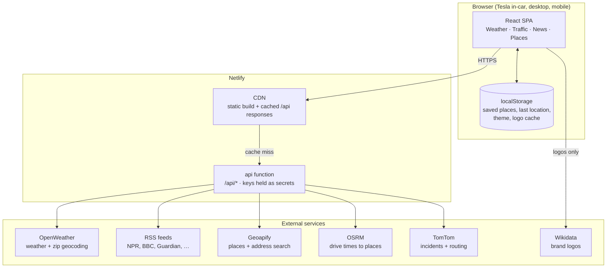
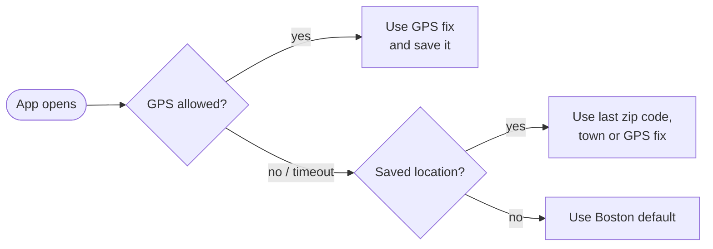
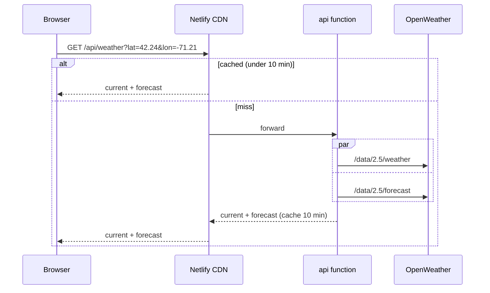
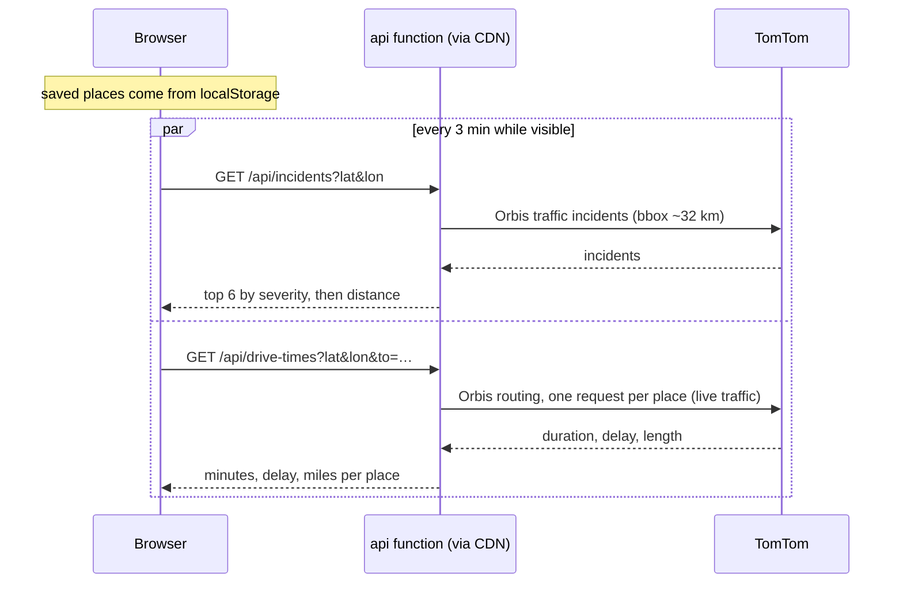
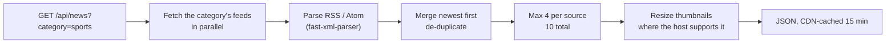
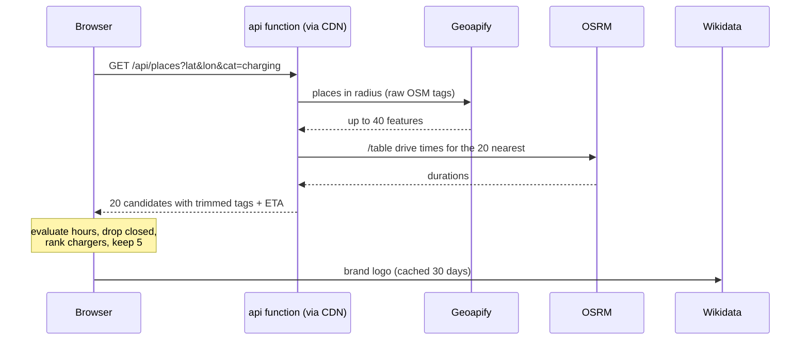

# Tesla Dashboard

[](https://teslaweather.netlify.app/)
[](https://app.netlify.com/projects/teslaweather/deploys)


A homepage for the Tesla in-car browser that shows weather, live traffic and drive times, news, and nearby EV chargers and places in a large, touch-friendly layout.

## What it does

- **Weather:** current conditions, a driving insight with estimated cold-weather range loss, a 12-hour temperature sparkline, and 5-day / 6-hour forecasts
- **Traffic:** live drive times and arrival times to your saved places, and traffic incidents near you
- **News:** headlines in six categories from free-to-read RSS feeds, with small thumbnails
- **Places:** the nearest places in six EV-focused categories, with addresses, open/closed status and drive times; chargers show plug types, speed and stalls, Tesla-compatible first
- **Location:** GPS when the browser allows it, otherwise the last zip code, town or location you set
- **Car-friendly UI:** 64 px touch targets, fonts sized for the ~773×601 Tesla viewport, light and dark mode that follows the car's Day/Night display

## Contents

- [Architecture](#architecture)
- [Tech stack](#tech-stack)
- [Location](#location)
- [Weather](#weather)
- [Traffic](#traffic)
- [News](#news)
- [Places](#places)
- [Data model](#data-model)
- [Infrastructure and configuration](#infrastructure-and-configuration)
- [Project structure](#project-structure)
- [Local development](#local-development)
- [Deployment](#deployment)
- [Observability](#observability)
- [Known constraints](#known-constraints)
- [Roadmap](#roadmap)

## Architecture

### System overview



The browser only talks to its own origin, except for Wikidata brand logos. Each tab's data flow is described in the feature sections below.

### API routes

All routes are served by one Netlify Function, `netlify/functions/api.mjs`, which dispatches to handlers in `netlify/lib/`.

| Route | Handler | Upstream | CDN cache |
|---|---|---|---|
| `/api/weather?lat&lon` | `weather.mjs` | OpenWeather current + 5-day forecast | 10 min (+20 min stale) |
| `/api/geocode?zip[&country]` | `weather.mjs` | OpenWeather zip geocoding | 30 days |
| `/api/news?category` | `news.mjs` | 3–4 RSS/Atom feeds per category | 15 min (+30 min stale) |
| `/api/places?lat&lon&cat` | `places.mjs` | Geoapify Places + OSRM `/table` | 10 min (+20 min stale) |
| `/api/incidents?lat&lon` | `traffic.mjs` | TomTom Orbis traffic incidents (v2) | 2 min (+2 min stale) |
| `/api/drive-times?lat&lon&to` | `traffic.mjs` | TomTom Orbis routing (v3), up to 5 destinations | 2 min (+2 min stale) |
| `/api/town?lat&lon` | `weather.mjs` | OpenWeather reverse geocoding: town for an incident ("Medway, MA") | 30 days |
| `/api/search?text[&type=city][&lat&lon]` | `traffic.mjs` | Geoapify autocomplete: addresses (saved places) or US towns (`type=city`) | 1 day |

Every route validates its input (coordinates range-checked and rounded, categories checked against fixed lists), and errors return `{ error, retryable }` without upstream URLs, which contain keys.

## Tech stack

| Layer | Technology |
|---|---|
| UI | React 18, React Context, Tailwind CSS 3 with CSS-variable theme tokens |
| Icons | React Icons: Feather (UI), Lucide (theme Auto) and Weather Icons |
| Maps | Leaflet 1.9 with OpenStreetMap tiles (incident details only, lazy-loaded) |
| Build | Vite 7 |
| Server | One Netlify Function (Node, esbuild bundler) |
| Caching | Netlify CDN (`Netlify-CDN-Cache-Control: durable`) |
| Parsing | fast-xml-parser (RSS/Atom), opening_hours (OSM hours), DOMPurify (URL sanitising) |
| Testing | Vitest 4 |
| Quality | ESLint 9, Husky + lint-staged, ggshield secret scanning, commitlint |

## Location

- On startup the app asks for GPS (10 s timeout). If GPS is blocked, as it often is in the Tesla browser, it uses the last location you set; with nothing saved it falls back to Boston
- **Change location** in the header takes a US zip code, a town name (suggestions such as "Medfield, MA" appear as you type, up to 4, kept above the Tesla keyboard) or a fresh GPS fix; any of them is saved for next time. A town picked by name is shown in the header
- Coordinates are rounded before each request (about 1.1 km for weather and incidents, 110 m for places) so nearby users share CDN cache entries



## Weather

- **Hero:** temperature, condition icon, and a **Driving** insight from current conditions: wet roads, low visibility, strong wind or gusts over 30 mph, plus an estimated highway range loss in cold weather
- **Wind tile:** speed, compass direction the wind comes from ("14 mph NW") with an arrow pointing downwind, and gusts when they run 5+ mph above the steady wind
- **12-hour sparkline:** hourly temperatures interpolated from OpenWeather's 3-hour forecast intervals
- **Conditions tiles** and a **5-Day / 6-Hour** forecast toggle
- One `/api/weather` call returns both current conditions and the forecast; the function calls OpenWeather's two endpoints in parallel



## Traffic

- **Drive times** (left column): a 2×2 grid of up to 4 saved places (Home, Work, …) with live minutes (coloured by delay), distance and arrival time; tap a tile for its details and the voice command to navigate there. A free slot shows an Add place tile. Places are added by address search and stored **only in this browser**
- **Traffic near me** (right column): up to 6 incidents within about 10 miles, most severe first, with road, from → to, delay and distance. Tap one for a details window (severity, delay and length, when it started and is expected to clear) with a small map of the affected stretch (Leaflet + OpenStreetMap tiles, loaded only when opened)
- Refreshes every 3 minutes while the page is visible; it pauses while the screen is off or the tab is hidden, and refreshes on return if the data is stale



## News

- Six categories: Headlines, Tech, Business, Science, Sports, Entertainment
- Sources (no paywalls): NPR, PBS NewsHour, The Guardian, BBC, Ars Technica, Engadget, CNBC, Phys.org, ScienceDaily, CBS Sports, Yahoo Sports, Variety, Deadline
- The function fetches a category's 3–4 feeds in parallel, merges them newest first, removes duplicates, and keeps at most 4 per source and 10 in total. If one feed fails the others still show
- Thumbnail URLs from NPR, Variety, Deadline and CBS Sports are rewritten to request 240 px images; thumbnails lazy-load



## Places

- Six categories with search radii tuned to how dense each type is: Food 5 km, Charging 16 km, Hotels 8 km, Shopping 4 km, Fun 5 km, Services 4 km (definitions in `src/shared/placeCategories.js`). No Gas: this is an EV app
- Five results in a 2×3 grid; the first card is featured and spans two rows. Tapping a card opens a details window with what to say to the car's voice assistant (“Navigate to …”), the address, hours, phone and website, and a Google Maps directions button
- **Every card:** name, type, street address, distance and drive time, open/closed (when OpenStreetMap has hours), brand logo or monogram
- **Chargers:** plug types (Tesla, CCS, CHAdeMO, J1772), maximum kW and stall count, plus Free / Customers only / network chips. Sorted Tesla plug → CCS → unknown → other plugs, then by distance
- **Hotels:** star rating and room count when available
- Opening hours are evaluated in the browser, because the function runs in UTC
- Attribution: Powered by Geoapify · © OpenStreetMap contributors · ODbL



## Data model

There is no database. User data lives only in the visitor's browser, so nothing personal is stored on the server.

| localStorage key | Contents | Written by |
|---|---|---|
| `tesla.savedPlaces.v1` | Up to 4 saved places: `{ id, label, address, lat, lon }` | Traffic card |
| `tesla.lastLocation.v1` | Last location set: `{ lat, lon, label, town }` (4 dp) | Location (GPS, zip code or town) |
| `tesla.themeMode.v1` | `auto`, `light` or `dark` | Theme button (Auto follows the car's Day/Night display) |
| `wd_brand_{qid}` | Wikidata brand logo URL, 30-day expiry | Places |

Server-side caching is entirely Netlify CDN entries keyed by each route's query parameters (see [API routes](#api-routes)).

## Infrastructure and configuration

| Piece | Role | Status |
|---|---|---|
| Netlify site `teslaweather` | Static hosting, CDN, function runtime | Live |
| `api` Netlify Function | `/api/*` proxy; rate limit 120 requests / 60 s per IP | Live |
| OpenWeather | Weather and zip geocoding | Free plan |
| Geoapify | Places and address search | Free plan |
| TomTom | Traffic incidents and routing (key needs **Traffic API** and **Routing API** enabled) | Free plan |
| OSRM, Wikidata, RSS feeds | Drive times to places, logos, news | Public, no key |

### Environment variables

| Variable | Used by | Secret |
|---|---|---|
| `OPENWEATHER_API_KEY` | `/api/weather`, `/api/geocode` | Yes |
| `GEOAPIFY_API_KEY` | `/api/places`, `/api/search` | Yes |
| `TOMTOM_API_KEY` | `/api/incidents`, `/api/drive-times` | Yes |
| `VITE_DEFAULT_LAT`, `VITE_DEFAULT_LON` | Browser build: fallback location (Boston) | No |

In Netlify, set each secret with scope **Functions**, mark it **Contains secret values**, and give it a value in **every deploy context**: draft deploys run as Deploy Previews and get no value otherwise. Locally, `netlify dev` reads them from `.env` (template: `.env.example`). Never give a secret a `VITE_` prefix: Vite builds every `VITE_*` value into the public bundle.

## Project structure

```
TeslaApp/
├── netlify/
│   ├── functions/api.mjs        # /api/* router + rate limit
│   └── lib/
│       ├── http.mjs             # errors, JSON + cache headers, fetch timeout, validation
│       ├── weather.mjs          # /api/weather, /api/geocode, /api/town
│       ├── news.mjs             # /api/news: feeds, RSS parsing, thumbnails
│       ├── places.mjs           # /api/places: Geoapify + OSRM
│       └── traffic.mjs          # /api/incidents, /api/drive-times, /api/search
├── src/
│   ├── App.js                   # Tabs
│   ├── index.js / index.css     # Entry point, theme tokens
│   ├── api/client.js            # Browser client for /api/*
│   ├── context/
│   │   ├── TeslaAppContext.js   # Location + weather state
│   │   └── ThemeContext.jsx     # Auto (follows the car) / Light / Dark
│   ├── components/
│   │   ├── LocationSelector.jsx # Header: Change location, Auto/Light/Dark button
│   │   ├── Weather.jsx
│   │   ├── Traffic.jsx          # Location guard
│   │   ├── TrafficCard.jsx      # Drive times and incidents near me
│   │   ├── News.jsx
│   │   ├── Places.jsx
│   │   ├── DetailSheet.jsx      # Shared details-window frame, stat tiles, blocks
│   │   ├── PlaceSheet.jsx       # Place details: stats, voice command, address, contact
│   │   ├── IncidentSheet.jsx    # Traffic incident details
│   │   └── IncidentMap.jsx      # Leaflet map of the incident (lazy-loaded)
│   └── shared/
│       ├── placeCategories.js   # Category radii + Geoapify keys (shared with the function)
│       ├── charging.js          # Charger plugs/kW/stalls (shared with the function)
│       ├── savedPlaces.js       # Traffic saved places (localStorage)
│       ├── savedLocation.js     # Last location (localStorage)
│       ├── sunTheme.js          # Light/dark from sunrise/sunset (fallback)
│       ├── wind.js              # Wind mph, compass direction, gusts
│       ├── placeDetails.js      # Voice phrase, phone and website formatting
│       ├── directions.js        # Google Maps directions link
│       └── Spinner.jsx
├── tests/unit/
│   ├── functions/api.test.mjs   # Routes, validation, caching, key-leak safety
│   └── shared/charging.test.js
├── docs/                        # Contributing, security notes, Places history
├── public/                      # Icons, manifest
├── netlify.toml                 # Build, functions, dev server, SPA redirect
├── CHANGELOG.md
└── CLAUDE.md                    # Instructions for Claude Code
```

## Local development

Prerequisites: Node.js 20.19+ (or 22.12+), the Netlify CLI (`npm install -g netlify-cli`), and API keys in `.env` (`cp .env.example .env`). Commit hooks also need `brew install ggshield` and `ggshield auth login`.

```bash
npm install          # also installs the Husky git hooks
npm start            # netlify dev: app + /api on http://localhost:3000
npm run dev:vite     # Vite only; /api routes won't respond
npm test             # Vitest unit tests
npm run lint         # ESLint
npm run build        # production build to build/
```

## Deployment

- Hosted on Netlify at [teslaweather.netlify.app](https://teslaweather.netlify.app/); every push to `main` builds and deploys to production
- GitHub Actions CI (`.github/workflows/ci.yml`) runs lint, tests and the build on every push and pull request; it reports a check but doesn't block Netlify's deploy
- Netlify runs `npm run build`, publishes `build/`, and bundles `netlify/functions/` with esbuild
- To test before production: `netlify deploy` creates a draft deploy with its own URL
- Verify after a deploy: each `/api/*` route returns 200, and no API key string appears in the JavaScript files under `/assets/`

## Observability

| What | Where |
|---|---|
| Deploys and build logs | Netlify dashboard → Deploys |
| Function logs (upstream errors, rejected keys) | Netlify dashboard → Logs → Functions |
| CDN cache behaviour | `Cache-Status` response header (`"Netlify Durable"; hit`) |
| API usage and quotas | OpenWeather, Geoapify and TomTom dashboards |
| CI results | GitHub → Actions → CI |
| Dependency alerts and updates | GitHub Dependabot: security alerts + automated fix PRs; monthly npm and weekly GitHub Actions update PRs (`.github/dependabot.yml`) |

## Known constraints

- **Tesla browser geolocation:** GPS is often blocked in the car, so the app relies on the saved location, a zip code or a town
- **TomTom free tier:** about 2,500 requests a day. Each traffic refresh costs 1 incidents call plus 1 routing call per saved place
- **OpenStreetMap coverage:** opening hours, addresses and charger details are only as complete as the OSM data; places without hours show no open/closed pill
- **No live charger availability:** OpenStreetMap has no stall-availability data
- **Incident map tiles:** standard OpenStreetMap tiles, allowed for light use with attribution under the OSM tile policy; heavy use would need a tile provider (CARTO's free basemaps now require a key). Dark mode inverts the tiles with a CSS filter
- **Some thumbnails stay large:** Engadget, Yahoo Sports and PBS ignore resize parameters
- **Bundle size:** about 184 KB gzipped app code plus 45 KB React (the `opening_hours` parser is a large share)
- **Function 404s:** Netlify replaces a function's 404 body, so "location not found" is returned as 422

## Roadmap

Shipped work is listed in [CHANGELOG.md](CHANGELOG.md).

- [ ] Rotate the OpenWeather key (it was committed to this public repo in 2022) and delete the unused `VITE_API_KEY`, `VITE_API_URL` and `VITE_DEFAULT_LAT` Netlify variables
- [ ] Code-split `opening_hours` to shrink the initial bundle
- [ ] Route planning with charging stops
- [ ] Offline mode

## Contributing and license

See [docs/CONTRIBUTING.md](docs/CONTRIBUTING.md) and [docs/SECURITY.md](docs/SECURITY.md). Licensed under the [MIT License](LICENSE). This is an unofficial project and is not affiliated with Tesla, Inc.

_Maintained by John Xanthopoulos_
